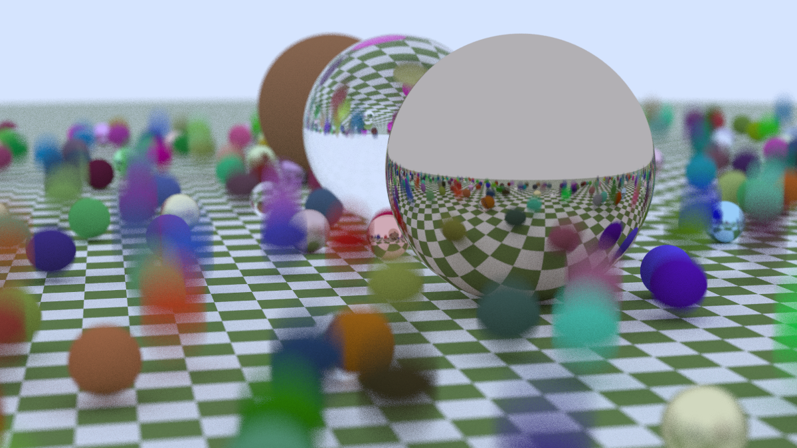
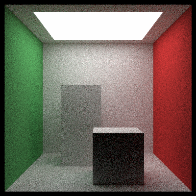
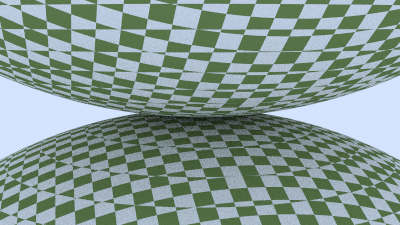
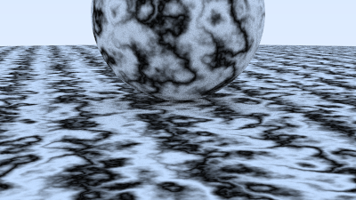

# Ray Tracer

Following Peter Shirley *Ray Tracing in One Weekend Series* with my own multi-threaded render architecture to improve rendering performance. Here are some results:

## Gallery

| Cornell Box | Checkered Spheres | Perlin Noise |
| --- | --- | --- |
|  |  |  |

## References

- https://raytracing.github.io/